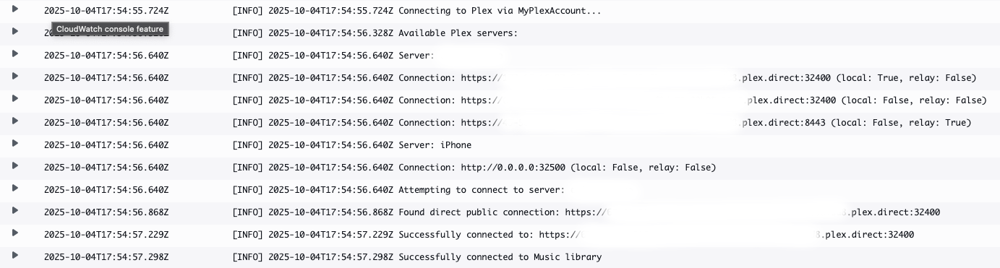
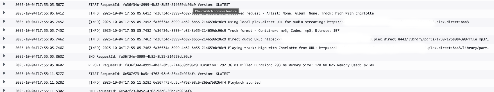
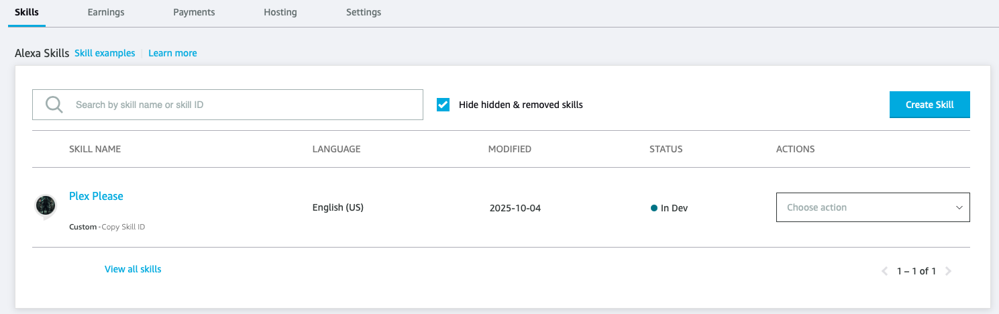
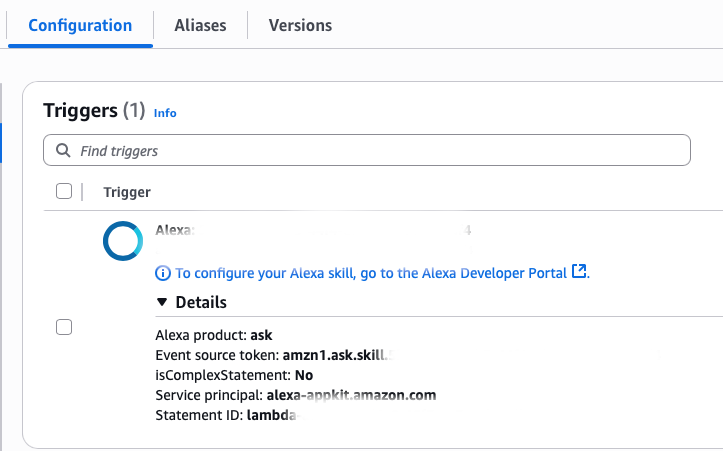
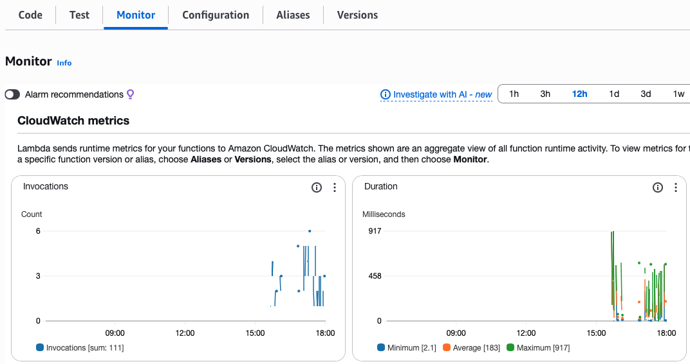
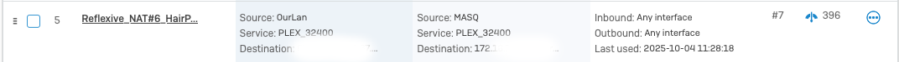

# alexa-plex-music-player-skill

[](https://opensource.org/licenses/MIT)


This is an Alexa skill that allows playback of audio from Plex Music libraries on Alexa/Echo devices.

## Features

- **Full Plex Integration**: Play tracks, albums, artists, and playlists from your Plex Music library
- **Continuous Playback**: Seamless playback of queued music without interruption
- **Next/Previous Controls**: Skip forward and backward through your queue
- **Shuffle Mode**: Random playback of your music selection
- **Persistent Queue**: Uses DynamoDB to maintain your queue across sessions
- **Automatic Relay Detection**: Intelligently handles both local and remote playback
- **Works Across Alexa Devices**: Tested on Alexa and Echo devices
- **Handles Large Playlists**: Optimized to prevent lambda/queue timeouts

## Usage

### Create your AWS Lambda

1. Create a new AWS Lambda using the latest Python runtime
2. Copy and paste your `PLEX_TOKEN` and `PLEX_SERVER_NAME` into the `lambda_function.py` code
3. Build the deployment package (installs dependencies and creates `lambda-deployment.zip`):
   ```bash
   ./build.sh
   ```
   The script targets the Python 3.12 / x86_64 Lambda runtime by default. For a different runtime, set `PYTHON_VERSION` and/or `ARCH`, e.g. `PYTHON_VERSION=3.13 ARCH=aarch64 ./build.sh`.
4. Upload `lambda-deployment.zip` to the AWS Lambda Console
5. Deploy your new code!

To deploy later changes from the command line, install and configure the [AWS CLI](https://docs.aws.amazon.com/cli/latest/userguide/getting-started-install.html), then run:
```bash
./deploy.sh
```
This builds the package and uploads it to the function named `PlexAlexaMusicSkill` (override with `FUNCTION_NAME=YourFunction ./deploy.sh`). See [Updating Your Skill](AWS_SETUP.md#updating-your-skill) for details.

Examples of successful invocations:





### Create your Alexa Skill

1. Create a new Alexa skill in the [Alexa Developer Console](https://developer.amazon.com/alexa/console/ask)
   - Choose any skill name you like (e.g., "Plex Please") - this is separate from your invocation phrase
2. Set your invocation phrase (what you'll say to activate the skill)
3. Configure your endpoint:
   - Select "AWS Lambda ARN"
   - Enter your Lambda function ARN
4. Copy the Skill ID for use in the AWS Lambda Trigger configuration
5. Set up the interaction model:
   - Navigate to the JSON Editor
   - Paste the contents from `intent_model.json` (or equivalent file in this repo)



### Set up the AWS Lambda Trigger

1. In your Lambda function, add a new trigger
2. Select trigger type: **Alexa Skills Kit**
3. Paste your Skill ID from the previous step
4. Click **Add**



### Monitor Invocations

You can monitor your skill's performance in the AWS Lambda console:



### Local Network Configuration

**Important:** For local playback to work properly, you need to enable hairpin NAT (also called NAT reflection or NAT loopback) on your firewall or gateway. This allows devices on your local network to access your Plex server using its public IP address.

The setting may be labeled differently depending on your device:
- **Hairpin NAT**
- **NAT Reflection**
- **NAT Loopback**
- **DNS Rebind**

Example configuration on a Sophos XG firewall:



## Contributing

Contributions are welcome! Please feel free to submit a Pull Request.

1. Fork the repository
2. Create your feature branch:
   ```bash
   git checkout -b feature/amazing-feature
   ```
3. Commit your changes:
   ```bash
   git commit -m 'Add some amazing feature'
   ```
4. Push to the branch:
   ```bash
   git push origin feature/amazing-feature
   ```
5. Open a Pull Request

Please make sure to update tests as appropriate and follow the code style guide.

## License

Copyright (c) 2025 Erin L. Kolp (<erinlkolpfoss@gmail.com>)

Licensed under the MIT License. See [LICENSE](LICENSE) file for details.
